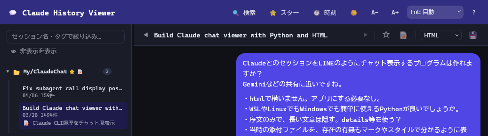

# Claude History Viewer

Claude Code のセッション履歴を LINE のようなチャット形式で表示する Python 製ビューアです。


---

## スクリーンショット



| ライトモード | ダークモード |
|---|---|
| ユーザー発言が右（紫バブル）、Claude が左（白バブル） | 同じレイアウト、背景が暗色 |

---

## 特徴

### チャット表示

- **LINEライクなチャット表示** — ユーザー発言は右、Claude の返答は左のバブルで表示
- **長文の折りたたみ** — 行数・文字数の閾値を超えたメッセージは「続きを見る」ボタンで展開（設定可能）
- **ツール呼び出しの可視化** — 📖Read / ✏️Edit / 💻Bash 等をチップ表示。ファイル名も確認できる
- **画像インライン表示** — ScreenShot 等の画像はバブル内に表示、クリックで拡大
- **思考プロセスの表示** — 🤔「思考プロセス」として折りたたみ表示
- **実装計画ブロック** — Plan モードで生成された実装計画を 📋「実装計画」として折りたたみ表示
- **コードブロックコピー** — コードブロックにホバーすると「コピー」ボタンが表示される
- **数式表示 (LaTeX)** — `$$…$$` `\[…\]` をディスプレイ数式、`\(…\)` `$…$` をインライン数式として KaTeX で描画。表のセル内でも有効
  - KaTeX は同梱のためネット接続不要
  - `$…$` は `echo $PATH` や「$100 から $200」を数式と誤認しないよう、開き `$` の直後・閉じ `$` の直前に空白がある場合や中身が数字だけの場合は数式扱いしない
  - コードブロック / インラインコードの中は常に対象外。リテラルの `$` は `\$` と書く

### UI / テーマ

- **ダーク / ライトモード** — ワンクリック切替、設定は保存
- **フォントサイズ調整** — A+ / A- で変更、設定は保存
- **フォント選択** — 自動優先順または個別指定、設定はブラウザに保存
- **時刻表示の切替** — 各メッセージの日時を表示 / 非表示
- **スクロールジャンプ** — ↑ / ↓ ボタンでチャットの先頭・末尾へ即移動

### メモ・整理

- **スター・タグ・メモ** — メッセージ / セッション / プロジェクト単位でメモを記録
- **選んでゴミ箱へ** — 要らないセッションを選んで捨てる。元の場所とバックアップの両方から移るので、一覧が軽くなる。ゴミ箱から戻すことも、消去してディスクを空けることもできる（[下記](#ゴミ箱)）
- **容量の表示と並べ替え** — セッションごとの大きさを出し（50 MB 以上は赤）、容量の大きい順にも並べられる
- **スター一覧ビュー** — スター付きセッション / メッセージを一覧表示、クリックで該当箇所にジャンプ

### 検索・ナビゲーション

- **全文検索** — Ctrl+K で起動。全プロジェクト横断検索、テキスト / ファイル名で種別指定可能。発言の本文とファイル名だけの索引を作っておくので、履歴が数 GB あっても 1 秒かからない
- **階層表示** — 検索結果はフォルダ → セッション → メッセージの階層でまとめて表示
- **サイドバー絞り込み** — セッション名またはタグ名でリアルタイムフィルタリング
- **前後セッション移動** — ◀ ▶ ボタンでセッション間を移動（先頭・末尾はグレーアウト）

### プロジェクト管理

- **サイドバーリサイズ** — ドラッグで幅を自由に調整
- **プロジェクトのラベル編集** — 右クリックメニューからサイドバー表示名を変更可能
- **フォルダを開く** — プロジェクト名にホバーすると ⧉ ボタンが表示され、クリックでエクスプローラーを開く
- **プロジェクトバッジ** — スター付き・メモありのプロジェクトに ⭐ 📝 バッジを常時表示

### エクスポート

- **HTML / Markdown エクスポート** — 形式を選択して 💾 ボタンでダウンロード。HTML は現在のテーマを維持、Markdown はテキストのみを抽出
- **エクスポート HTML は単体で完結** — 数式を含む場合は KaTeX の CSS とフォントを data URI で埋め込むため（+約 400KB）、ビューアを停止した状態でもオフラインで正しく表示される

---

## 必要環境

| 項目 | 要件 |
|---|---|
| Python | 3.10 以上 |
| 外部ライブラリ | **不要**（標準ライブラリのみ） |
| OS | Windows / WSL / Linux / macOS |
| Claude Code | `~/.claude/projects/` にセッションデータがあること |

---

## インストール

```bash
git clone --recursive https://github.com/lancard-aikawa/ClaudeHistoryViewer.git
cd ClaudeHistoryViewer
```

追加インストールは不要です。`--recursive` で、バックアップに使う [SessionVault](https://github.com/lancard-aikawa/SessionVault) も `vendor/SessionVault` に入ります。
`--recursive` を付けずにクローンしたときや、SessionVault を新しくするときは次を実行します。

```bash
git submodule update --init          # 取っていなければ取る
git submodule update --remote        # SessionVault を最新にする（そのあとビューアを再起動）
```

---

## 使い方

### 初回セットアップ

設定ファイルのサンプルをコピーして使います。

```bash
# Linux / macOS / WSL
cp settings.json.sample settings.json

# Windows (コマンドプロンプト)
copy settings.json.sample settings.json

# Windows (PowerShell)
Copy-Item settings.json.sample settings.json
```

`settings.json` は `.gitignore` に含まれているため、個人設定がリポジトリに混入しません。

### 基本起動

```bash
python claude_chat_viewer.py
```

起動後、自動でブラウザが開きます（`http://localhost:57080`）。

### Windows で裏で動かす（start.cmd / stop.cmd）

コンソールの窓を出さずに（`pythonw`）動かすときは、ダブルクリックで使えます。

| ファイル | 動き |
|---|---|
| `start.cmd` | 動いているビューアを止めてから起動する（再起動にも使う）。引数はビューアに渡る（例: `start.cmd --no-browser`） |
| `stop.cmd` | ビューアを止める |

- 止める相手は、コマンドラインにこのフォルダの `claude_chat_viewer.py` を含む Python のプロセスだけです
- 起動できなかったとき（ポートが使用中など）はエラーを出して止まります。理由は `python claude_chat_viewer.py --no-browser` で見られます
- ビューアは同じポートで二重に起動できません。2 つ目は「ポートを使えません」で終わります

### オプション

```bash
# ポートを変更
python claude_chat_viewer.py --port 9090

# ブラウザを自動で開かない
python claude_chat_viewer.py --no-browser

# Claude データディレクトリを明示指定
python claude_chat_viewer.py --claude-dir /custom/path/.claude
```

### WSL から Windows ブラウザで開く場合

```bash
python claude_chat_viewer.py --no-browser
# → http://localhost:57080 をブラウザで手動アクセス
```

---

## 操作ガイド

### サイドバー

| 操作 | 内容 |
|---|---|
| プロジェクト名をクリック | セッション一覧を展開 / 折りたたむ |
| プロジェクト名を右クリック | コンテキストメニュー（スター / メモ / ラベル編集 / フォルダを開く） |
| プロジェクト名にホバー → ⧉ | エクスプローラーでフォルダを開く |
| セッションをクリック | チャット表示 |
| 上部テキストボックス | セッション名またはタグ名でリアルタイム絞り込み |
| サイドバー右端をドラッグ | 幅を調整 |
| ⇅ 日付 / ⇅ 容量 | セッションを新しい順 / 大きい順に並べる |
| ☑ 選択 | 選ぶモード。セッションを押すと選ぶ（Shift+クリックで範囲）。下の欄の「全選択」「解除」「🗑 捨てる」で操作する |
| 👁 非表示 | 非表示にしたプロジェクト・セッションも出す |
| セッションを右クリック | 非表示にする / 🗑 捨てる |

### チャットヘッダー

チャット上部のセッション操作ボタンです。

| ボタン | 機能 |
|---|---|
| ◀ / ▶ | 前 / 次のセッションへ移動（端はグレーアウト） |
| ☆ / ⭐ | セッションのスター付け外し |
| 📝 | セッションのメモ・タグ編集 |
| HTML / MD セレクト ＋ 💾 | 選択した形式でセッションを保存 |

### ツールバーボタン

| ボタン | 機能 |
|---|---|
| 🔍 検索 | 検索パネルを開く（Ctrl+K も可） |
| ⭐ スター | スター付きセッション / メッセージの一覧 |
| 🧠 メモリ | Claude Code の memory の一覧（[下記](#メモリ)） |
| 🗑 ゴミ箱 | 捨てたセッションの一覧。戻す / 消去する（[下記](#ゴミ箱)） |
| 🕐 時刻 | 時刻表示の切替 |
| 🌙 / ☀️ | ダーク / ライトモード切替 |
| A- / A+ | フォントサイズ変更 |
| Fnt: ドロップダウン | フォント選択（自動優先順 / 個別指定） |
| ⚙ 設定 | ビューアと Claude Code の設定画面（下記） |

#### フォント選択について

「自動」を選ぶと `Cascadia Code → Cascadia Mono → Consolas → BIZ UDゴシック → Noto Sans Mono` の順に、インストール済みのフォントが自動で使われます。VS Code が入っていれば通常 Cascadia Code が適用されます。個別に選ぶ場合はドロップダウンから指定してください。設定はブラウザに保存されます。

### メッセージ操作

メッセージにマウスを乗せると操作ツールバーが表示されます。

| ボタン | 機能 |
|---|---|
| ☆ / ⭐ | スターの付け外し |
| 📝 | メモ・タグの編集 |
| 📋 | メッセージテキストをクリップボードにコピー |

### 検索

- **テキスト検索** — メッセージ本文を横断検索
- **ファイル名検索** — ツール呼び出し中のファイルパスで検索
- スコープ選択で特定プロジェクトのみに絞り込み可能
- 結果は **フォルダ → セッション → メッセージ** の階層構造で表示
  - セッション名をクリック → そのセッションにジャンプ
  - メッセージをクリック → 該当メッセージにスクロール＆ハイライト

### プロジェクトの右クリックメニュー

プロジェクト名を右クリックするとメニューが表示されます。

| 項目 | 機能 |
|---|---|
| ☆ スター | スターの付け外し |
| 📝 メモ・タグ | メモとタグの編集 |
| ✏️ ラベルを編集 | サイドバーに表示する名前を変更（空にするとパス表示に戻る） |
| ⧉ フォルダを開く | エクスプローラーでプロジェクトフォルダを開く |

---

## 設定ファイル（settings.json）

ツールバーの **⚙ 設定** から画面で変更できます。表示に関わる設定は保存するとすぐ反映され、「再起動後に反映」の印が付いた項目（ポート・バックアップなど）はビューアの再起動後に効きます。

`settings.json.sample` をコピーした `settings.json` を直接編集してもかまいません（その場合は再起動後に反映）。

```jsonc
{
  "port": 57080,               // ポート番号
  "auto_open_browser": true,  // 起動時にブラウザを自動で開く

  "collapse_lines": 15,       // これ以上の行数で本文を折りたたむ
  "collapse_chars": 600,      // これ以上の文字数で折りたたむ（行数・文字数どちらか先に達した方が適用）
  "preview_chars":  300,      // 折りたたみ時に表示するプレビュー文字数

  "show_thinking":   true,    // 思考プロセスブロックを表示する
  "show_tool_chips": true,    // ツール呼び出しチップを表示する
  "max_search_results": 300,  // 検索結果の最大件数

  "archive_enabled": true,    // セッションのバックアップを取る
  "archive_dir": "",          // 保存先（空なら ~/.claude/chat-viewer-archive）
  "archive_interval_min": 10  // バックアップを取り直す間隔（分）
}
```

> `port` と `auto_open_browser` はコマンドライン引数（`--port`, `--no-browser`）で上書きできます。
> 上書き不可のキーは無視されます（型が異なる場合も同様）。

### Claude Code の設定

設定画面の「Claude Code」タブでは、`~/.claude/settings.json` の次の項目を変更できます。変更は次に起動する Claude Code から効きます。

| 分類 | 項目 |
|---|---|
| 保存 | セッションの保存期間（`cleanupPeriodDays`） |
| 表示 | テーマ・描画方式（`tui`）・ツール出力の全表示・ヒント・進捗バー・アニメーション |
| 通知 | 通知の方法・スマホへのプッシュ通知 |

- 「既定」を選ぶと、その項目をファイルから消して Claude Code の既定値に戻します
- 上に無い項目（`permissions` / `hooks` / `env` など）は画面から変更できず、ファイルに書かれたまま残ります。ビューアは認証のないローカル HTTP サーバのため、コマンド実行や権限に関わる項目は編集できないようにしています
- 「settings.json（閲覧）」タブでファイル全体を見られます。`env` の値と、token / key / secret などを含む名前の値は `***` で伏せています

### 設定の優先順位

```
コマンドライン引数  >  settings.json  >  デフォルト値
```

---

## データとメタデータ

| ファイル / ディレクトリ | 内容 |
|---|---|
| `~/.claude/projects/` | Claude Code が生成するセッションデータ（JSONL）。**読み取りのみ** |
| `~/.claude/chat-viewer-meta.json` | スター・タグ・メモの保存先（本ツールが作成） |
| `~/.claude/chat-viewer-cache.json` | セッション一覧のために読んだ結果（題・時刻・件数）。消しても読み直すだけ |
| `~/.claude/chat-viewer-search-index.json` | 全文検索の索引（発言の本文とファイル名だけ。履歴 2.6 GB で約 30 MB）。消しても作り直すだけ |
| `~/.claude/chat-viewer-trash/` | ゴミ箱。捨てたセッションの置き場所 |
| `~/.claude/chat-viewer-archive/projects/` | セッションデータのバックアップ（内蔵のバックアップが作成） |
| SessionVault の保管庫（`mirror/`・`index/memory.json`） | SessionVault を使うときのバックアップと memory の索引 |

> セッションデータ自体は変更しません。

### セッションのバックアップ

Claude Code は `cleanupPeriodDays`（既定 **30 日**）より古いセッションファイルを起動時に削除します。そのままでは 1 か月より前の会話はビューアに表示できなくなります。

これを防ぐため、ビューアは起動時と `archive_interval_min` 分ごとに `~/.claude/projects/` のセッションファイルをバックアップ先へコピーします。

- 元のファイルが消えても、バックアップから一覧・表示・検索ができます。サイドバーでは「保存分」の印が付きます
- 同じセッションが両方にあるときは元のファイルを読みます
- バックアップ先のファイルは自動では削除しません。不要なセッションは[ゴミ箱](#ゴミ箱)へ捨てると、バックアップからも消えます
- ビューアを起動していない間に 30 日を過ぎたファイルは守れません。Claude Code 側でも `~/.claude/settings.json` に `"cleanupPeriodDays": 3650` などを設定して、保存期間を延ばしておくことをおすすめします
- バックアップの状況（最後に取った時刻と結果）は 設定 → ビューア の一番下に出ます

#### SessionVault に任せる

[SessionVault](https://github.com/lancard-aikawa/SessionVault)（Claude Code のセッションを残し・検査し・直す CLI）は
`vendor/SessionVault` にサブモジュールとして入っていて、読み込めればバックアップをそちらに任せます。設定は不要です。

既定では、保管庫は `vendor/SessionVault/vault` にできます。SessionVault を別の場所にクローンしてタスクスケジューラで定期実行しているなど、
**同じ保管庫を使いたいときは、その SessionVault の設定ファイルを指定します**（設定画面のバックアップからも変えられます。再起動後に反映）。
指定しないと、保管庫が 2 つに分かれます。

```json
"sessionvault_config": "C:/Repos/mywork/SessionVault/sessionvault.json"
```

- 設定ファイルに `vault` が書かれていなければ、その設定ファイルの隣の `vault/` を使います（SessionVault を単体で動かしたときと同じ場所）
- 同梱のものではなく、別の場所の SessionVault を読み込むときは `sessionvault_src` にその `src` フォルダを書きます。
  このときの設定ファイルの既定は、そのリポジトリ直下の `sessionvault.json` です

- 内蔵のバックアップはセッション本体の JSONL を写すだけですが、SessionVault はサブエージェント・長いツール結果・memory も残し、
  元のファイルが縮んだり壊れたりしても前の版を世代として残します
- 保存先は SessionVault の設定（`sessionvault.json` の `vault`）に従い、`archive_dir` は使いません。前に内蔵のバックアップで写したものは、引き続き `archive_dir` から読みます
- SessionVault のタスクスケジューラの定期実行と重なったときは、その回を見送って次の回に取ります
- 読み込めないとき（フォルダが違う、など）は内蔵のバックアップで動きます

### ゴミ箱

履歴が増えて重くなったら、要らないセッションを捨てます。

1. サイドバーの「☑ 選択」を押す（「⇅ 容量」にすると大きい順に並ぶ）
2. セッションを押して選ぶ。Shift+クリックで範囲、「全選択」で開いているプロジェクトの見えているもの全部（絞り込みと組み合わせられる）
3. 下の「🗑 捨てる」を押す。1 件だけなら、セッションを右クリックして「🗑 捨てる」でもよい

捨てると、次のものがまとめて `~/.claude/chat-viewer-trash/` へ移ります。元の場所だけを消すとバックアップから表示され続けるので、両方から移します。

- `~/.claude/projects/<プロジェクト>/<セッション>.jsonl` と、`<セッション>/`（サブエージェント・長いツール結果）
- SessionVault の保管庫の `mirror/` と `generations/`（前の版）にある同じもの
- 内蔵のバックアップ（`archive_dir`）にある同じもの

- ヘッダーの「🗑 ゴミ箱」で、捨てたものの一覧を見られます。「↩ 戻す」で元の場所へ戻し、「✕ 消去」「✕ 空にする」で本当に消します。**消去するまでディスクは空きません**
- 5 分以内に書き込まれたセッションは、Claude Code で使っている途中かもしれないので移しません
- バックアップを取っている最中は、終わるのを待ってから移します（SessionVault を別に定期実行していて重なったときは、あとでやり直すよう表示します）
- ファイルを別のアプリが開いていて移せないときは、そのセッションは移さず元のまま残します
- 消去すると、そのセッションのスター・メモ・タグも消えます。Claude Code の `--resume` でも開けなくなります

### メモリ

ヘッダーの「🧠 メモリ」で、Claude Code の memory（`~/.claude/projects/<プロジェクト>/memory/*.md`）を一覧できます。

- 各 memory を開くと本文と、それを書いた（Write / Edit した）会話の一覧が出ます。会話を押すとその会話を開きます
- どの会話で書いたかは SessionVault の索引（`<保管庫>/index/memory.json`）から読みます。SessionVault を使っていなければ一覧と本文だけです
- Claude Code から消えた memory も、保管庫に残っていれば本文を表示します

---

## データ形式

Claude Code は `~/.claude/projects/<プロジェクト名>/<セッションID>.jsonl` に各セッションを保存します。

プロジェクト名はワーキングディレクトリのパスをエンコードしたものです（例: `f--Repos-My-ClaudeChat` → `f:\Repos\My\ClaudeChat`）。

---

## 既知の制限事項・注意点

### ツール実行中のユーザー発言が表示されない

Claude Code がツール呼び出し（Read / Bash / Agent 等）を連続実行している最中にユーザーがメッセージを送った場合、そのメッセージが JSONL に `text` ブロックとして記録されないことがあります。Claude はその発言を受け取って応答しているにもかかわらず、ビューアには表示されません。

これは Claude Code 側の記録仕様によるものであり、ビューア側では対処できません。

### スキル展開メッセージは非表示

`/skill-name` を呼び出すと、Claude Code がスキルの内容を `user` メッセージとして JSONL に挿入します。これはユーザーが実際に入力したテキストではないためビューアでは非表示にしています（直前のアシスタントバブルにスキル名のチップとして表示されます）。

---

## ライセンス

MIT
